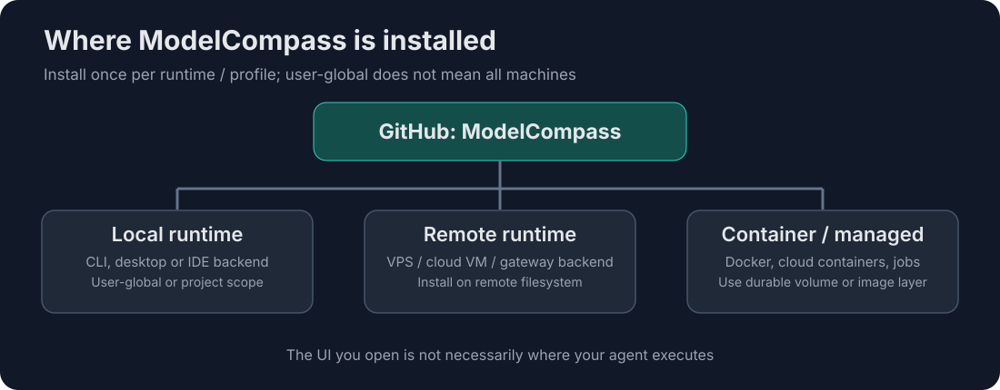
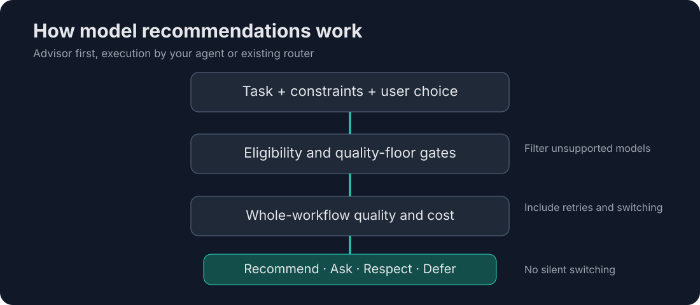

# ModelCompass 🧭

**Find your best AI model. Keep control of the choice.**

**Pick the right AI model for the *whole job*, not just the cheapest next prompt.**

[](https://agentskills.io/specification) [](LICENSE) [](tests/)

> **Status: public-ready preview.** Advisory skill and curated reference, **not** a model router, a benchmark leaderboard, or a live price feed. All candidate rankings are editorial unless specifically supported by measured tests.

ModelCompass is an **open, explainable model-selection advisor** for humans and AI agents. It matches your task, modality, quality needs, budget, privacy constraints, and session continuity to a practical model choice. It can suggest alternatives but **never silently overrides your decision**.

## Why does this exist?

A model that costs less per token may cost more per *completed task* after retries and context handoffs. Switching from model A to B to C during one codebase reorganization can lose important context. And choosing maximum reasoning for a routine file inventory is not necessarily useful. This skill puts those tradeoffs in one reusable decision process.

### What makes this different?

| Conventional selector | ModelCompass |
|---|---|
| Picks a model for one request | Evaluates the **whole workflow** including handoffs |
| Focuses on benchmark or token price | Uses **quality floors**, retries, context overhead, and costs |
| Routes requests silently | **Advisory**, **Grill Me**, and **Strict Preference** modes |
| Primarily chat/text | Covers **code, documents, images, video, audio, classification**, and specialized tools |
| One-size-fits-all ranking | Task-specific recommendations with **evidence labels** |

## Works with your existing model picker or router

> **Add advice, not another routing layer.** ModelCompass recommends *which model fits the whole task*; Hermes `/model`, OmniRouter / OmniRoute, OpenRouter Auto Router, LiteLLM, or another router retains responsibility for *what is configured and what actually runs*. No automatic override, interception, or integration is implied.

| System | What it already handles | What ModelCompass adds | Actual integration status |
|---|---|---|---|
| [Hermes `/model`](https://github.com/NousResearch/hermes-agent/blob/main/website/docs/reference/cli-commands.md) | Displays and switches among configured models within a session | Task-fit advice, reasoning-effort guidance, switching-cost warnings | **Advisory via agent skill**; no automatic `/model` execution |
| Hermes model configuration / auxiliary slots | Configures providers, default reasoning effort, and task-specific auxiliary models | Suggestions for main vs auxiliary workload and quality floors | **Advisory only**; not changing `config.yaml` |
| OmniRouter / OmniRoute and similar gateways | Model aliases, provider selection, fallback, and policies depending on deployment | Suggests task-fit and flags quality-degrading fallback choices | **Advisory compatibility only**; no verified API integration |
| [OpenRouter Auto Router](https://openrouter.ai/docs/guides/routing/routers/auto-router) | Task-aware model selection, cost tiers, eligibility filters, and session stickiness | Helps compare whether Auto Router or a fixed model makes more sense for a complete workflow; explains tradeoffs | **Advisory compatibility**; no programmatic configuration or route override |
| Other intelligent routers (e.g. [RouteLLM](https://github.com/lm-sys/RouteLLM), [Not Diamond](https://www.notdiamond.ai/)) | Their own model ranking and routing policy | User-facing second opinion, task requirements, reliability and handoff-cost review | **Conceptual compatibility**; adapter not implemented |
| [LiteLLM Router](https://docs.litellm.ai/docs/routing) | Deployment choice, load balancing, retries, fallbacks and routing groups | Quality and workflow advice *before* requests reach the router | **Conceptual compatibility**; no gateway plugin |
| Other model-aware agents | May automatically choose providers or models | Optional explainable second opinion with human approval | Depends on the agent exposing skills and selection controls |

### Who has the final say?

1. **Your explicit model choice** wins unless you authorize changing it or it cannot perform the requested task.
2. **ModelCompass** may flag a meaningful improvement and offer *Use recommendation / Keep my choice / Grill Me*; it cannot silently rewrite a router's policy.
3. **The agent's model picker or router** remains the execution authority. It applies availability, credentials, provider limits, fallbacks, and actual routing policies.
4. **Dynamic routers can disagree**, because availability or error conditions change after advice is given. When the final provider is unknown, explain uncertainty rather than claiming that a recommendation was followed.

**Router coexistence modes:** **Observe** (describe configured/router-selected model when observable), **Advise** (suggest a fixed model or guardrail to the user), or **Defer** (leave routing unchanged). These are interaction policies, not implemented router API adapters. If a router exposes neither selected-model metadata nor configuration, state that uncertainty.

**Avoid dueling optimizers:** if a router already performs task-aware routing, use ModelCompass as an *audit or human-facing advisory layer*, or disable its proactive suggestions. Do not run competing auto-select policies that repeatedly change one another's choices.

**OpenRouter nuance:** `openrouter/auto` can select different models by task and use session stickiness, while provider routing and provider fallbacks are distinct mechanisms. ModelCompass should not mistake a provider fallback for a model-quality decision or claim that its preferred model was used without inspecting reported model metadata. [OpenRouter Auto Router documentation](https://openrouter.ai/docs/guides/routing/routers/auto-router).

**Switching is not free:** Hermes documents that changing models mid-session resets model-specific prompt caching and can trigger context compression. Compare the expected quality gain against recaching and handoff costs; often it is better to keep one model for the workflow. See [Hermes model configuration](https://github.com/NousResearch/hermes-agent/blob/main/website/docs/user-guide/configuring-models.md).

### Example: Hermes or an existing router

```text
User:     I'm restructuring a repository. I chose Maximum reasoning.
Advisor:  Medium may be sufficient for inventory and planning; the same
          model can keep the context across phases. Keep Maximum, use
          Medium, or Grill Me on the tradeoffs?
User:     Keep Maximum.
Advisor:  Understood. Your selection remains unchanged.
Runtime:  Hermes /model (or the configured router) still determines the
          model actually used and handles any permitted fallback.
```

This is an illustrative conversation, **not** a claim of a built-in native integration. It also doesn't claim that a skill can change a model or router configuration without explicit host support.

## Where does it install?



**The install target is the agent runtime, not the interface you use to reach it.** A global install applies across projects in that particular user/runtime. It does not automatically propagate from your laptop to a remote gateway or managed service. The [environment and scope table](#supported-installation-environments-and-scopes) explains the differences.

## Quick start

### Install globally for your agent (recommended)

Requires Node.js/npm for the `npx` command; installations are performed **in the environment where the command runs**.

After this repository is published, replace `OWNER` with its GitHub owner:

```bash
# Preview what skills are available, without installing
npx skills add OWNER/modelcompass --list

# Install for Codex across projects on this machine
npx skills add OWNER/modelcompass --skill model-selector --global --agent codex

# Install for Claude Code across projects on this machine
npx skills add OWNER/modelcompass --skill model-selector --global --agent claude-code

# Detect compatible agents interactively (choose global when prompted)
npx skills add OWNER/modelcompass --skill model-selector --global
```

`--global` means **all projects in that user environment**, not every machine or remote agent. Prefer interactive installation first to inspect the destination. CLI documentation: [Vercel Labs Skills](https://github.com/vercel-labs/skills/blob/main/docs/commands.md).

### Try before publishing (from a local checkout)

```bash
npx skills add . --skill model-selector --global --agent codex
python tests/validate_package.py
```

The `npx` CLI is **third-party tooling**. Review commands, install destinations, and its current security posture before running. It may create symlinks or copies depending on the environment.

### Use it

Ask a skill-compatible assistant:

> Use model-selector: I'm reorganizing a monorepo and want to keep cost low without losing quality. I already chose a high reasoning setting. Would you keep it?

Or:

> Grill Me about choosing a model for image generation with limited credits.

A good response gives a **Best Fit, Best Value, Budget, and Fallback**, the evidence and assumptions behind each, and the option to **keep your original choice**. Installing a skill **does not change your active model or enable programmatic model switching**. Auto-loading depends on the agent's skill discovery and task matching; when in doubt, explicitly say `use model-selector`.

## Human-readable guide

No agent required. Open [MODEL_HELPER.md](MODEL_HELPER.md) to browse the frozen V2.1 decision policy and task-by-model matrix. The same material is separated into smaller modules for agents to read on demand.

## Supported installation environments and scopes

**Scope** answers *which projects* see the skill; **execution environment** answers *which filesystem and process* can see it. A desktop UI connected to a remote runtime does not imply the skill has been installed remotely.

| Environment | Installation approach | Important caveat |
|---|---|---|
| Local Windows/macOS/Linux | Run the installer for each compatible local agent | User-global is specific to the current OS user |
| Cloud VM / VPS | Run the same installer on the remote host | Requires login and a persistent user home |
| Docker / container | Run inside the container, or mount a supported persistent skill directory | A disposable image layer loses changes when rebuilt |
| Kubernetes / managed cloud | Bake skill into image or mount persistent/configured volume | Follow platform lifecycle, filesystem and security rules |
| Cloud development workspace | Run inside that workspace | Workspace may be ephemeral |
| Provider-hosted managed agent | Use only vendor-supported skill/upload mechanism | Some environments cannot install arbitrary skills |
| Project-only | Omit `--global` and select a project target | Installs only for that project |

**Hermes:** Hermes Desktop, CLI, and gateway are *interfaces or processes*, not inherently three locations. If they share one runtime/home/skill directory, one install may suffice; if isolated, install separately. Check Hermes' actual skill support and configured directories before claiming `npx` directly supports that Hermes build. For a Hermes version not recognized by the Skills CLI, use [the manual skill bundle](skills/model-selector/) with the **documented Hermes skill installation mechanism**, then verify discovery via its own CLI. Don't assume a gateway on another host sees local files.

**Codex / Claude Code:** choose `--global` to make the skill available across projects **in that installation**. A coding agent launched inside a repository can still install user-globally. Remote Codex/Claude sessions may require installing in their own runtime.

### Where files live

```text
modelcompass/
├── README.md                 # public entry point and installation
├── MODEL_HELPER.md           # portable frozen human reference
├── skills/
│   └── model-selector/
│       ├── SKILL.md          # compact agent procedure
│       ├── references/       # selective loading
│       └── data/             # starter curated JSON indexes
├── tests/                    # structural and behavior fixtures
├── CONTRIBUTING.md
├── SECURITY.md
└── LICENSE
```

The **frozen selection principles** live in `MODEL_HELPER.md`; the split references implement them. JSON indexes are **starter candidates**, not an exhaustive machine-readable mirror and **not a live source of truth**. The documents label provider-confirmed information, editorial assessments, tested outcomes, and unverified facts. Update model facts with dates and citations, and keep selection principles consistent.

## How the advisor decides



The diagram shows the **advisory** flow, not an automatic router: the user can always keep an explicitly chosen model. Whole-workflow overhead and model-switching cost matter alongside per-token pricing.


1. Identify **goal and full workflow** (not just the next microtask).
2. Apply hard gates for **modality, language fidelity, privacy, format, tool access, context and budget**.
3. Read only relevant task, model, effort, and cost modules.
4. Compare models by **quality of validated outcome**, reliability, retries, latency, API/media price, handoff cost, and evidence quality.
5. Prefer a capable **single lead model** when switching would waste context; use deterministic tools for inventories, hashes, moves, and validation.
6. Provide **Best Fit / Best Value / Budget / Fallback**, confidence, dated price information (or explicitly unknown), and reason.
7. Respect the user's choice: **Advisory** (default), **Grill Me** (interactive), **Strict Preference** (no optimization nudges), or **Auto-select** only by explicit delegation.

### Example: restructuring a repository

```text
You:  Use my chosen model at maximum reasoning for everything.

Skill: Your chosen model can do the job. Medium reasoning may be a
       better starting point for inventory, classification and planning;
       deterministic tools should handle file moves. Higher effort is
       justified if unresolved architectural conflicts appear.

       1) Use the recommended reasoning level
       2) Keep your original selection
       3) Grill Me: compare alternatives
```

The sample is **illustrative**, not a measured provider-specific comparison. Agent hosts may expose different reasoning options; the skill should never invent an `extreme` setting.

## Costs, model coverage and evidence

Includes GPT, Claude, Gemini, DeepSeek, Qwen, Kimi, Grok, Mistral, Llama/open-weight families, and specialized image/video/audio systems. **Coverage is curated, not a claim that every historical or current model is listed.**

| Mark | Meaning |
|---|---|
| `D` | Provider-documented feature or price with attributable source/date |
| `E` | Editorial model/task recommendation, unproven comparative ranking |
| `T` | Tested on a reproducible task; requires saved evidence |
| `U` | Not yet verified |

We deliberately **do not** invent API prices, subscription quotas, availability, native capabilities, benchmark results, or savings percentages. A blank price means *unknown*, not *free*. Media models are compared in relevant units (image/clip/seconds/audio), not as if everything were tokens.

Useful outside sources: [Agent Skills specification](https://agentskills.io/specification), [Artificial Analysis](https://artificialanalysis.ai/), [LiteLLM](https://github.com/BerriAI/litellm), [OpenAI prices](https://openai.com/api/pricing/), [Anthropic prices](https://docs.anthropic.com/en/docs/about-claude/pricing), [Gemini prices](https://ai.google.dev/gemini-api/docs/pricing). Their data is **not bundled, continuously queried, or redistributed** by this release.

## Validation and safety

```bash
python tests/validate_package.py
python tests/run_evaluations.py
```

The first checks paths, links, schema shape, and basic policy invariants. The second reports **scenario coverage**, not a model benchmark; it does not contact paid APIs. To earn evidence mark `T`, contributors must provide actual reproducible task outcomes, costs, runtime, and model/version details.

Skills are untrusted code/instructions until reviewed. This project has **no credential collection, no network installer of its own, and no auto-switching hooks**. Nothing should move files, spend credits, leak source code to providers, or switch models without authorization.

## Updates and removal

```bash
# Review available updates; do not assume updates are automatic
npx skills check
# Update intentionally (review release notes / diff first)
npx skills update model-selector
# Remove global installations managed by Skills CLI
npx skills remove model-selector --global
```

A removed skill does not remove this repository or reset independent runtime configuration. Manual Hermes installs must be removed using that Hermes environment's own procedure.

## Roadmap

- [x] Context-first portable guide and advisory skill
- [x] Task modules and small structured starter catalog
- [x] Global-by-choice cross-agent install instructions
- [x] Offline package validations and scenario fixtures
- [ ] Verify skill discovery in real Codex, Claude Code, and Hermes installations
- [ ] Run independent representative task/quality/cost evaluations
- [ ] Optional price import with source licensing, dates, and integrity checks
- [ ] Optional interactive selector UI, still under user control
- [ ] Community-maintained evidence-backed recommendations
- [ ] Optional, independently tested adapters for OpenRouter and other routers (only with user authorization)

## Diagrams and attribution

The README diagrams use **Deployment/Architecture** and **Flowchart** diagram types with a dark, minimal editorial treatment inspired by [cathrynlavery/diagram-design](https://github.com/cathrynlavery/diagram-design) (MIT). They are self-contained, hand-authored SVG files committed under [`assets/diagrams/`](assets/diagrams/), not generated by or dependent on that skill at runtime.

## Community

Found a better model for a task, a pricing change, or a runtime compatibility issue? Open an issue with **model/version, task, quality threshold, setup, actual cost/latency, and reproducible evidence**. See [CONTRIBUTING.md](CONTRIBUTING.md). Forks and independent reviews welcome. ⭐

**License:** [MIT](LICENSE). No affiliation with model vendors, the Agent Skills project, or the Skills CLI maintainers.