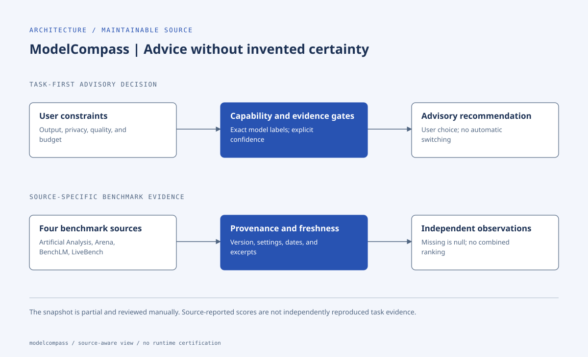

# ModelCompass 🧭

**An advisory skill for choosing an AI model for the whole job.**

ModelCompass helps humans and agents weigh task requirements, modalities, quality,
privacy, total cost and session continuity. It suggests **Best Fit**, **Best Value**,
**Budget** and **Fallback** candidates, while respecting the user's existing choice.

This is a portable [Agent Skill](https://agentskills.io/specification), not a model
router, hosted service or live pricing feed. Provider families and task shortlists
are editorial guidance, not measured model rankings. It does not call model APIs,
change host settings or silently switch models.

## Quick start

Read [`skills/model-selector/SKILL.md`](skills/model-selector/SKILL.md), or install
that directory using your agent's skill mechanism. Keep its `references/`, `data/`
and `scripts/` directories together. Host support and model availability vary.

With the third-party [Skills CLI](https://github.com/vercel-labs/skills), which
requires Node.js/npm:

```bash
# Inspect available skills before installation
npx skills add Guilsc/modelcompass --list
# Optional: install for Codex in this user's environment
npx skills add Guilsc/modelcompass --skill model-selector --global --agent codex
# From a local checkout, use the current local version instead
npx skills add . --skill model-selector --global --agent codex
```

A GitHub installation uses published files, not your uncommitted local edits.
`--global` applies to the user environment where the command runs, not all machines
or remote agents. Inspect the destination and follow your host's documentation;
ModelCompass does not guarantee compatibility with every agent.

Example request:

> Recommend a model for reviewing a Python service. I need reliable tool use,
> have a fixed budget, and want to keep my current model unless a change is material.

The advisor applies capability and privacy gates first, uses relevant evidence,
accounts for retries and context handoffs, and asks before switching. Existing
routers retain execution authority; see [router interoperability](skills/model-selector/references/router-interoperability.md).

## Benchmark evidence

The repository includes a **small, partial manual snapshot**, checked on
**2026-11-03**, from all four requested sources:

| Source | Incorporated evidence | Main limitation |
| --- | --- | --- |
| [Artificial Analysis](https://artificialanalysis.ai/models) | Intelligence Index v5.0 source-reported observation | Composite index and specific reasoning setting, not task-specific proof |
| [Arena](https://arena.ai/leaderboard) | Agent listing, quote and explicitly missing numeric score | Extracted percentage lacks an explicit metric definition; not assumed to be Elo or win rate |
| [BenchLM](https://benchlm.ai/) | BenchAlign overall observation marked estimated | Aggregated upstream evidence is not another independent measurement |
| [LiveBench](https://livebench.ai/) | LiveBench 2.0 overall observation | Version-specific weighted suites; settings and publication date not captured |

Sources remain distinct: no averaged scores, cross-site global ranking, alias
merging or invented zeroes for missing data. Source model labels are **not API IDs**.
These observations do not establish model availability or universal recommendations.

Inspect the evidence offline with Python 3.11+ (standard library only):

```bash
python skills/model-selector/scripts/benchmarks.py
python skills/model-selector/scripts/benchmarks.py --source benchlm --as-of 2026-11-03
python skills/model-selector/scripts/benchmarks.py --model 'Gemini 4 Carbon (High)'
```

JSON output includes provenance, exact labels, metric/version/category, units,
evidence kind, publication/observation dates, missing reasons and freshness.
The default age window is 30 days, overridable with `--max-age-days`. Unknown
publication dates are **not** presented as fresh measurements. An absent exact
label returns `status: no_observations`, not a negative recommendation.

See [benchmark policy and update instructions](skills/model-selector/references/benchmarks.md)
and the [source registry](skills/model-selector/references/sources.md). The CLI
reads local JSON only; it is not a scraper or live benchmark runner.

## Selection flow



[Editable HTML/SVG source](docs/architecture.html) · [Diagram style](docs/assets/architecture.style.json)


## Repository layout

```text
MODEL_HELPER.md                    Portable standalone specification
skills/model-selector/
  SKILL.md                         Agent entry point and advisory procedure
  references/                      Task, cost, reasoning, routing and evidence policies
  data/                            Editorial catalogs, pricing policy, benchmark snapshot
  scripts/benchmarks.py             Offline evidence validation and inspection
assets/diagrams/                    Existing SVG installation/selection illustrations
tests/                             Package checks, policy fixtures, benchmark unit tests
.github/workflows/validate.yml      Offline CI checks
```

The standalone [`MODEL_HELPER.md`](MODEL_HELPER.md) describes the broader advisory
protocol. The packaged skill is the entry point for the new benchmark workflow.

## Development and verification

No Python dependencies, API keys or inference calls are needed:

```bash
git clone https://github.com/Guilsc/modelcompass.git
cd modelcompass
python tests/validate_package.py
python tests/run_evaluations.py
python -m unittest discover -s tests -p 'test_*.py'
```

Package validation checks layout and machine-readable resources. The evaluation
script checks the structure of six policy fixtures; it does **not** execute an
advisor or measure model quality. Unit tests exercise the offline evidence reader,
validation, exact-label filtering, missing data and freshness behavior. None of
these checks establishes real-world recommendation accuracy.

See [CONTRIBUTING.md](CONTRIBUTING.md), [tests/README.md](tests/README.md) and
[SECURITY.md](SECURITY.md). Preserve source data and test fixtures when contributing.

## License

[MIT](LICENSE). External benchmark content remains subject to its source's terms;
links and a partial snapshot do not imply affiliation or endorsement.
