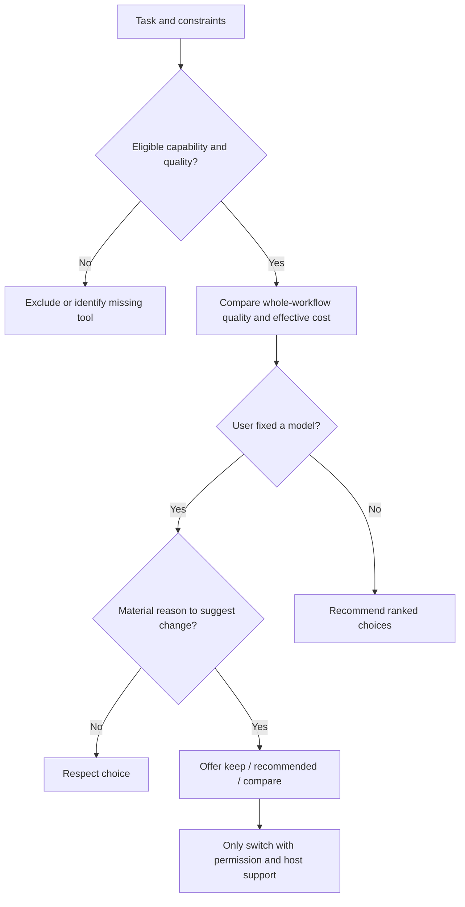

# Decision Rules

## Choose for the entire workflow
1. Identify task outcome, modality, budget, privacy, language, context, active model, host capabilities, and available router.
2. **Hard eligibility gates:** native modality support, output format, accuracy floor, safety, data-handling policy, language consistency, context limit, and actual environment availability. Do not rank ineligible candidates.
3. For eligible candidates compare outcome quality, reliability, session continuity, effective cost (input/output/cache/media + retries + context transfers), speed, and tool integration. Weight by task, not universal leaderboard position.
4. Present **Best Fit / Best Value / Budget / Fallback** with evidence: D=provider documented, T=independently tested, E=editorial, U=unverified. Unknown is not zero.
5. Favor one capable lead model for interdependent steps. Use scripts for inventories, hashing, moves, builds, tests. Only suggest split roles when material value exceeds handoff expense.
6. Start at moderate reasoning. Escalate for actual uncertainty, failed validation, conflicting constraints, or complex interdependencies; do not escalate automatically.
7. Explicit choice stays in force. Suggest improvements only if significant; wait for user approval before switching.

## Decision tree

Do not invent prices, benchmark scores, or silent model switching.
